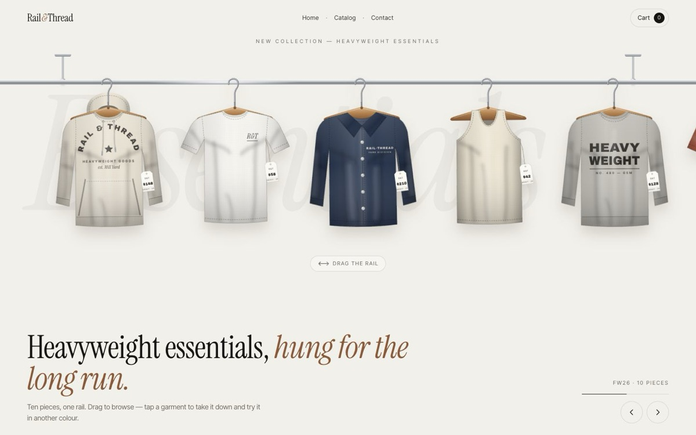

# Rail & Thread — Heavyweight Essentials

[](https://tabishhassan5121472.github.io/rail-thread-store/)


A minimal, off-white streetwear storefront built around a physical clothing rail you can drag, brush past and take garments down from.

**Live demo:** [https://tabishhassan5121472.github.io/rail-thread-store/](https://tabishhassan5121472.github.io/rail-thread-store/)

## Techniques
- **Procedural SVG garments** — hoodies, tees, a coach jacket, tank, crew and longsleeve generated in JS with blurred fold shadows, highlights, ribbing patterns, dashed stitched seams, printed wordmarks (text on paths) and hanging price tags.
- **Spring / pendulum physics** — each garment is a damped pendulum driven by the rail's velocity and acceleration and by the cursor's speed as it brushes past.
- **Momentum rail** — pointer drag with velocity sampling, exponential friction, rubber-band edges, horizontal wheel/trackpad and keyboard support. The loop sleeps when settled and pauses offscreen.
- **FLIP product view** — the garment lifts off its hanger and flies to the centre (GSAP), the page blurs back behind a backdrop filter, and the product panel slides in.
- **Live recolouring** — swatches change `@property`-registered CSS custom properties, so the SVG colours animate between values.
- Size selector with a sliding indicator, add-to-cart button that morphs into a checkmark, and a cart drawer with an animated subtotal and free-shipping meter.
- Split-text reveals, scroll-linked lookbook strip and a parallax fabric plate (GSAP ScrollTrigger).
- Supports `prefers-reduced-motion`, keyboard navigation, focus states and dialogs with `inert`.

Plain HTML/CSS/JS, no build step. GSAP 3.12.5 is loaded from a CDN. Every visual is drawn in code.


## Run locally

```bash
npx serve .
```

## License

MIT — free to learn from and reuse.
